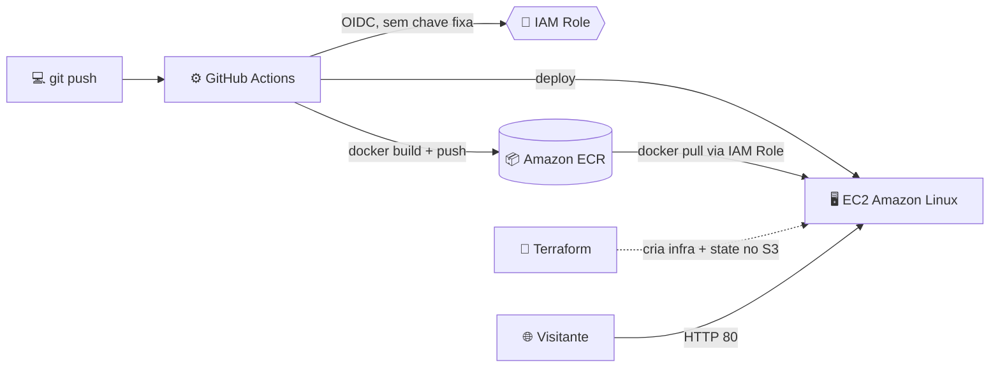

# 🚀 SuperEofim — Deploy automatizado e seguro na AWS (Docker · ECR · EC2 · Terraform · CI/CD)
 
Pipeline completo de **CI/CD** que constrói uma imagem Docker, publica no **Amazon ECR** e faz deploy em uma instância **EC2** — provisionada por **Terraform** e disparada por **GitHub Actions**, do build ao container no ar, sem clicar em nada no console.
 
> 💡 Projeto desenvolvido a partir da trilha **DevOps na prática** da [Maria Lazara](https://github.com/MariaLazara). O diferencial deste repositório é a camada de **segurança (DevSecOps)** aplicada em cima da trilha: autenticação sem credenciais fixas, menor privilégio e acesso restrito.
 
---
 
## 🏗️ Arquitetura
 

 
## 🧰 Stack
 
| Camada | Ferramenta |
|---|---|
| Aplicação | Site servido por container Docker |
| Registro de imagens | **Amazon ECR** (us-east-2) |
| Computação | **Amazon EC2** t3.micro, Amazon Linux 2023 |
| Infraestrutura como código | **Terraform** (state remoto no S3) |
| CI/CD | **GitHub Actions** |
| Autenticação | **OIDC** + **AWS IAM Roles** |
 
## 🔀 Os dois pipelines
 
**1. Infraestrutura (Terraform)** — `workflow_dispatch` com escolha de `plan`, `apply` ou `destroy`. Provisiona EC2, Security Group e regras de rede. O `user_data` instala o Docker na criação da instância.
 
**2. Aplicação (build + deploy)** — dispara no `push`. Faz `docker build`, envia a imagem para o ECR e aciona o deploy na EC2, que puxa a nova versão e sobe o container.
 
## 🔐 Decisões de segurança (o diferencial)
 
- **Zero credenciais no GitHub.** A autenticação com a AWS usa **OIDC**: o GitHub Actions troca um token de curta duração por credenciais temporárias, via IAM Role. Não existe `AWS_SECRET_KEY` guardada em secret.
- **Trust policy travada por repositório.** A role só pode ser assumida pelos meus repositórios, usando o formato de `sub` com **IDs numéricos imutáveis** (`repo:usuario@ID/*`), que impede que um repositório de mesmo nome recriado por terceiros assuma a role.
- **Menor privilégio por função.** A role da EC2 só tem `ReadOnly` no ECR (pull). A role do CI tem apenas o necessário para build/push e deploy. Nenhuma usa `AdministratorAccess`.
- **A EC2 não guarda chaves.** Ela acessa o ECR por **IAM Role**, com credenciais temporárias e renovadas automaticamente.
- **SSH restrito.** A porta 22 fica liberada apenas para um IP específico (`/32`). Para o deploy via CI, a próxima fase migra para **AWS SSM**, eliminando o SSH e mantendo a porta 22 fechada.
- **State remoto e versionado.** O `terraform.tfstate` fica em um bucket **S3** com versionamento e acesso público bloqueado, compartilhado entre a máquina local e o CI.
## 🐞 Problemas reais que resolvi
 
| Problema | Causa | Solução |
|---|---|---|
| SSH recusado com "Meu IP" liberado | O console pegou o **IPv6** (`/32` = bloco da operadora), mas o SSH saía por **IPv4** | Regra recriada com o IPv4 correto |
| OIDC: `Not authorized to assume role` | Trust policy com `sub` no formato antigo | Ajustada para o formato novo com IDs numéricos (`repo:user@ID/repo@ID`) |
| Pipeline não disparava no push | Gatilho esperava a branch `main`, mas o repo usava `master` | Alinhei a branch do gatilho |
| Step de `apply` sempre pulado | Condição `if` comparava com o nome de input errado | Corrigi o nome do input no `if` |
| `user_data` não instalava o Docker | Faltava o shebang `#!/bin/bash`; cloud-init ignora o script sem ele | Adicionado o shebang |
| SSH do runner travava no deploy | Security Group liberava só o meu IP, não o IP (dinâmico) do runner | Liberação temporária do IP do runner no pipeline (e migração planejada para SSM) |
 
**Diagnóstico de rede aprendido:** `timed out` indica bloqueio por firewall/Security Group; `refused` indica que o pacote chegou mas nada respondeu na porta; `No route to host` indica que a origem não alcança o destino (ex.: VM em rede host-only sem saída). Usei `Test-NetConnection` e `curl -I` para isolar cada camada.
 
## 🗺️ Próximos passos
 
- [ ] Deploy via **AWS SSM** (sem SSH, porta 22 fechada)
- [ ] Scan de segurança no pipeline: **Trivy** (imagem), **tfsec/Checkov** (Terraform), **Gitleaks** (segredos)
- [ ] Domínio próprio + **HTTPS** (Caddy ou Nginx + Let's Encrypt)
- [ ] **Elastic IP**
- [ ] Observabilidade (CloudWatch ou Prometheus + Grafana)
---
 
## 🙏 Créditos
 
Baseado na trilha **DevOps na prática** da [Maria Lazara](https://github.com/MariaLazara). As implementações de segurança e a documentação de troubleshooting acima são de minha autoria.
 
👤 **Caetano Nascimento** — desenvolvedor em transição para DevOps / DevSecOps
[GitHub](https://github.com/CaetanoNascimento) · [LinkedIn](https://linkedin.com/in/SEU-PERFIL)
 