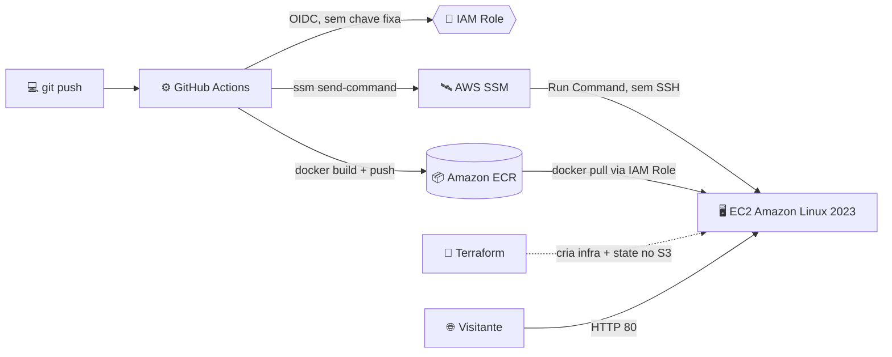

# 🚀 SuperEofim — Deploy automatizado e seguro na AWS (Docker · ECR · EC2 · Terraform · SSM · CI/CD)

Pipeline completo de **CI/CD** que constrói uma imagem Docker, publica no **Amazon ECR** e faz deploy em uma instância **EC2** via **AWS Systems Manager (SSM)** — infraestrutura provisionada por **Terraform** e tudo disparado por **GitHub Actions**, do build ao container no ar, sem clicar em nada no console e **sem SSH**.

> 💡 Projeto desenvolvido a partir da trilha **DevOps na prática** da [Maria Lazara](https://github.com/MariaLazara). O diferencial deste repositório é a camada de **segurança (DevSecOps)** aplicada em cima da trilha: autenticação sem credenciais fixas, menor privilégio, porta 22 fechada e nenhum valor sensível versionado.

---

## 🏗️ Arquitetura



## 🧰 Stack

| Camada | Ferramenta |
|---|---|
| Aplicação | Site estático servido por container **Nginx** |
| Registro de imagens | **Amazon ECR** (us-east-2) |
| Computação | **Amazon EC2** t3.micro, Amazon Linux 2023 |
| Deploy / acesso remoto | **AWS Systems Manager** (Run Command) |
| Infraestrutura como código | **Terraform** (state remoto no S3) |
| CI/CD | **GitHub Actions** |
| Autenticação | **OIDC** + **AWS IAM Roles** |

## 📁 Estrutura

```
.
├── .github/workflows/
│   ├── terraform.yaml          # pipeline de infraestrutura
│   └── deploy.yaml             # pipeline de build + deploy
├── infra-as-code/              # Terraform
│   ├── backend.tf  provider.tf
│   ├── ec2.tf                  # EC2 + Security Group (sem porta 22)
│   ├── ecr.tf
│   ├── variables.tf  outputs.tf
│   ├── user_data.sh            # instala Docker e garante o SSM Agent
│   └── terraform.tfvars.example
└── supereofim/                 # aplicação
    ├── dockerfile
    └── website/index.html
```

## 🔀 Os dois pipelines

**1. Infraestrutura (Terraform)** — `workflow_dispatch` com escolha de `plan`, `apply` ou `destroy`. Provisiona EC2, Security Group e regras de rede. O `user_data` instala o Docker (habilitado no boot) e garante que o SSM Agent está ativo.

**2. Aplicação (build + deploy)** — dispara no `push` quando algo em `supereofim/` muda (ou manualmente). Faz `docker build`, envia a imagem para o ECR com a tag do commit (`github.sha`) e `latest`, localiza a EC2 pela tag `Name=website_server` e executa o deploy com `aws ssm send-command`. O job espera o comando terminar, mostra a saída da instância no log e falha se o deploy falhar.

## 🔐 Decisões de segurança (o diferencial)

- **Zero credenciais no GitHub.** A autenticação com a AWS usa **OIDC**: o GitHub Actions troca um token de curta duração por credenciais temporárias, via IAM Role. Não existe `AWS_SECRET_KEY` guardada em secret.
- **Trust policy travada por repositório.** A role só pode ser assumida pelo meu repositório, usando o formato de `sub` com **IDs numéricos imutáveis** (`repo:usuario@ID/*`), que impede que um repositório de mesmo nome recriado por terceiros assuma a role.
- **Deploy via SSM, porta 22 fechada.** Não há regra de SSH no Security Group, nem key pair na instância, nem chave `.pem` em secret. O deploy é feito por **SSM Run Command**, autenticado e auditado pelo IAM/CloudTrail.
- **Menor privilégio por função.** A role da EC2 tem só `ReadOnly` no ECR (pull) e `AmazonSSMManagedInstanceCore`. A role de deploy só pode executar `ssm:SendCommand` em instâncias com a tag `Name=website_server`. Nenhuma usa `AdministratorAccess`.
- **A EC2 não guarda chaves.** Ela acessa o ECR por **IAM Role**, com credenciais temporárias e renovadas automaticamente. O **IMDSv2 é obrigatório**, o que protege essas credenciais contra ataques de SSRF.
- **Nada sensível versionado.** O VPC ID e os ARNs das roles vêm de **GitHub Secrets** (`TF_VAR_*`). Localmente, os valores ficam em `terraform.tfvars`, que é ignorado pelo `.gitignore` junto com `*.tfstate*`, `.terraform/` e `*.pem`. O repositório traz só um `terraform.tfvars.example` com valores falsos.
- **State remoto e versionado.** O `terraform.tfstate` fica em um bucket **S3** com versionamento e acesso público bloqueado, compartilhado entre a máquina local e o CI.

## ⚙️ Como usar

**Secrets do GitHub** (*Settings → Secrets and variables → Actions*):

| Secret | Uso |
|---|---|
| `AWS_ROLE_ARN_INFRA` | ARN da role assumida pelo pipeline do Terraform |
| `AWS_ROLE_ARN_DEPLOY` | ARN da role assumida pelo pipeline de build/deploy |
| `TF_VAR_VPC_ID` | VPC onde o Security Group é criado |

**Rodando o Terraform localmente:**

```bash
cd infra-as-code
cp terraform.tfvars.example terraform.tfvars   # preencha com seus valores
terraform init
terraform plan
```

## 🐞 Problemas reais que resolvi

| Problema | Causa | Solução |
|---|---|---|
| SSH recusado com "Meu IP" liberado | O console pegou o **IPv6** (`/32` = bloco da operadora), mas o SSH saía por **IPv4** | Regra recriada com o IPv4 correto |
| OIDC: `Not authorized to assume role` | Trust policy com `sub` no formato antigo | Ajustada para o formato novo com IDs numéricos (`repo:user@ID/repo@ID`) |
| Pipeline não disparava no push | Gatilho esperava a branch `main`, mas o repo usava `master` | Alinhei a branch do gatilho |
| Step de `apply` sempre pulado | Condição `if` comparava com o nome de input errado | Corrigi o nome do input no `if` |
| `user_data` não instalava o Docker | Faltava o shebang `#!/bin/bash`; cloud-init ignora o script sem ele | Adicionado o shebang |
| SSH do runner travava no deploy | Security Group liberava só o meu IP, não o IP (dinâmico) do runner | Migração do deploy para **AWS SSM**: sem SSH, sem IP para liberar, porta 22 fechada |
| Valores sensíveis (IP, VPC ID, ARNs) fixos no código | Terraform e workflows com valores hardcoded | Parametrizados com variáveis, `terraform.tfvars` ignorado e **GitHub Secrets** |

**Diagnóstico de rede aprendido:** `timed out` indica bloqueio por firewall/Security Group; `refused` indica que o pacote chegou mas nada respondeu na porta; `No route to host` indica que a origem não alcança o destino (ex.: VM em rede host-only sem saída). Usei `Test-NetConnection` e `curl -I` para isolar cada camada.

## 🗺️ Próximos passos

- [x] Deploy via **AWS SSM** (sem SSH, porta 22 fechada)
- [x] Parametrizar valores sensíveis (variáveis Terraform + GitHub Secrets)
- [ ] Scan de segurança no pipeline: **Trivy** (imagem), **tfsec/Checkov** (Terraform), **Gitleaks** (segredos)
- [ ] Domínio próprio + **HTTPS** (Caddy ou Nginx + Let's Encrypt)
- [ ] **Elastic IP**
- [ ] Observabilidade (CloudWatch ou Prometheus + Grafana)

---

## 🙏 Créditos

Baseado na trilha **DevOps na prática** da [Maria Lazara](https://github.com/MariaLazara). As implementações de segurança e a documentação de troubleshooting acima são de minha autoria.

👤 **Caetano Nascimento** — desenvolvedor em transição para DevOps / DevSecOps
[GitHub](https://github.com/CaetanoNascimento) · [LinkedIn](https://linkedin.com/in/SEU-PERFIL)
